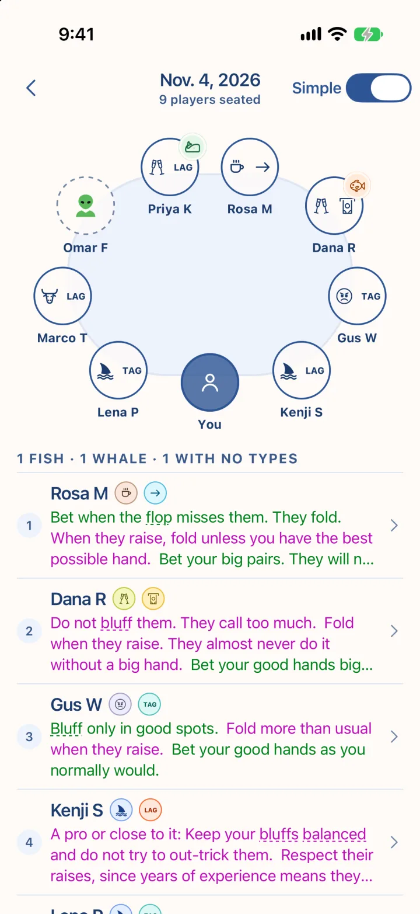
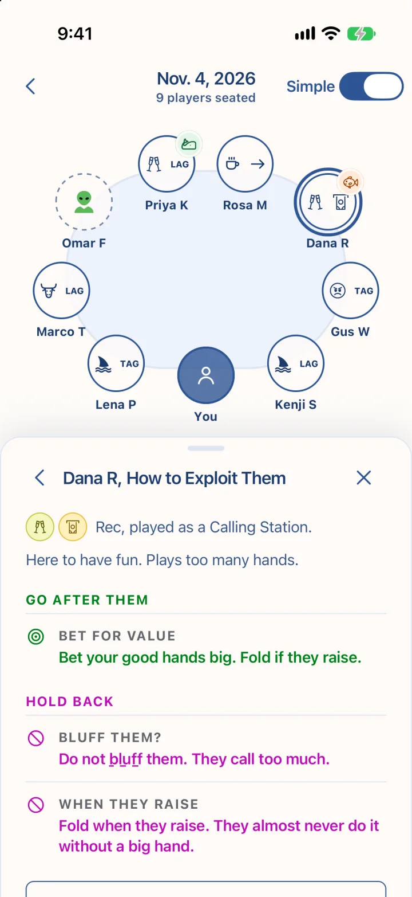
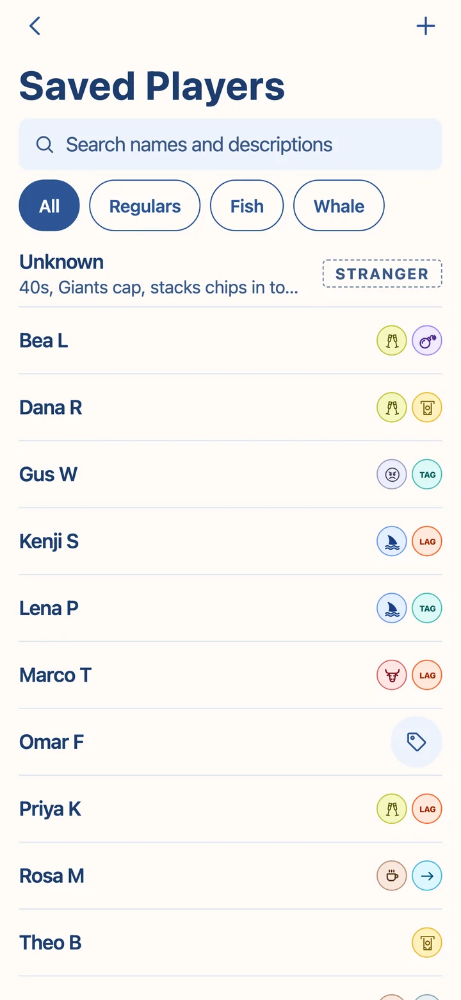
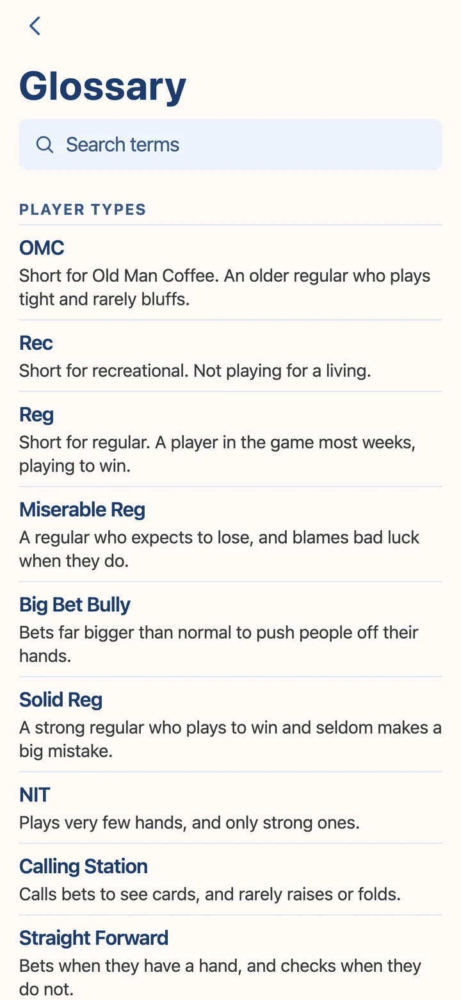

# SeatSpy

A phone app for live poker that keeps a read on every player at your table and shows you how to exploit them.

  
  
  
  

## Why I Built It

I play live poker against a lot of the same people, at a home game, in cash games and at the casino. I’d learn how someone played and forget most of it by the next session. My reads ended up in my head, in a notes app or nowhere. Poker apps mostly track hands and bankroll, and their player notes rarely say what to do about a read.

SeatSpy ties every read to a plan. You spot the type, then go after the mistakes that type makes.

## How a Session Works

Tap a seat to add someone from your book or a stranger. Tag each player with a type, like Calling Station, NIT or Maniac, or let Quiz Me ask what you’ve seen and rank the likely types. Each player’s panel then says when to bluff them, when to bet for value and when to back off.

Reads stay with the player. The next time they sit down, you start where the last session left off.

## What Else Is in It

- Each player can hold up to three of the twelve types.
- Simple Mode shows three plain lines per type, and Full Detail adds stats, bet sizing and preflop play.
- Log What They Did records a play or a tell and the type it points to.
- Incognito Mode shows tagged seats as dots, so nobody next to you can read your screen.
- Learn has a poker glossary, a card for every type and quizzes on both.

## Built With

SeatSpy is built with Expo and React Native, in TypeScript. Expo Router handles navigation, expo-sqlite keeps the book on the phone, and Reanimated and Gesture Handler run the table’s drag and press gestures. EAS Build makes the iPhone and Android builds, and EAS Update ships fixes over the air.

## Get the App

Request beta access at [colossalhippo.com/seatspy](https://colossalhippo.com/seatspy/). iPhone testers get a TestFlight invite at the email on their Apple ID. On Android, install it from [colossalhippo.com/seatspy/android](https://colossalhippo.com/seatspy/android/).

## About This Repo

This repo is the project page. The source code is private, and I’m not taking contributions. If something breaks, use Report a Bug in the app’s Settings.

## License

Copyright 2026 Nick Gassmann. All rights reserved.
